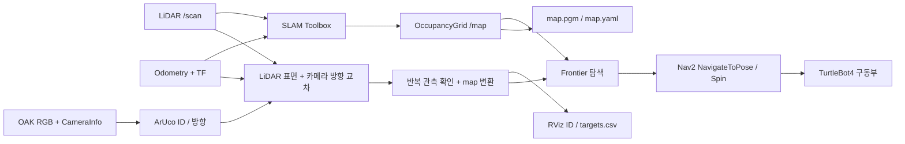

# TurtleBot4 파이널 프로젝트

[](https://github.com/JoonSimJoon/turtlebot4-osp-final-project/actions/workflows/ci.yml)

Ubuntu 24.04 / ROS 2 Jazzy 노트북에서 실행하는 **SLAM + Nav2 + 자율 탐색 + ArUco 표적 기록** 프로젝트입니다. 최초 설치와 로봇 연결 설정을 마치면 `./start.sh explore`로 과제 탐색을 시작합니다.

**실제 로봇의 ROS 버전도 Jazzy여야 합니다.** 현재 Mac은 개발·테스트용이며, 실물 주행은 Ubuntu 노트북을 기준으로 합니다. 학교 로봇이 Humble이면 로봇을 임의로 업그레이드하지 말고 배포판에 맞춘 조정이 필요합니다. 실물 주행과 현장 마커 오차는 아직 검증하지 않았습니다.

## 처음 한 번 준비

1. Ubuntu 24.04 노트북에서 공개 저장소를 내려받습니다.

```bash
git clone https://github.com/JoonSimJoon/turtlebot4-osp-final-project.git
cd turtlebot4-osp-final-project
```

2. 설치·빌드를 실행합니다. 인터넷과 관리자 비밀번호가 필요합니다.

```bash
./start.sh setup
```

3. `config/robot.env.example`을 `config/robot.env`로 복사해 학교 로봇의 설정과 맞춥니다. 설치 도구가 이미 만들었다면 그 파일을 편집합니다.

```bash
cp -n config/robot.env.example config/robot.env
nano config/robot.env
```

핵심은 `ROS_DOMAIN_ID`, `RMW_IMPLEMENTATION`, 필요 시 `ROS_DISCOVERY_SERVER`입니다. 카메라 토픽이 다르면 `IMAGE_TOPIC`, `CAMERA_INFO_TOPIC`도 수정합니다. 여러 팀의 로봇이 있는 공간에서는 로봇과 같은 도메인인지 확인해야 합니다.

4. 노트북과 로봇 Raspberry Pi의 유선 LAN을 직접 연결합니다. 공식 기본 이미지에서는 로봇 주소가 `192.168.185.3`입니다. Ubuntu **설정 → 네트워크 → 유선 → IPv4 → 수동**에서 노트북 주소를 `192.168.185.2`, 넷마스크를 `255.255.255.0`으로 설정합니다. 직접 연결용 인터페이스의 게이트웨이와 DNS는 비워 두고, 인터넷은 Wi-Fi를 사용합니다. 학교에서 변경한 주소가 있다면 그 설정을 따릅니다.

```bash
ping -c 3 192.168.185.3
./start.sh doctor --camera
```

`ping` 성공만으로 ROS가 연결된 것은 아닙니다. doctor에서 scan, odom, 카메라 영상·보정값, TF 수신이 확인되어야 합니다. 로봇의 센서·드라이버는 기존 onboard bringup이 실행 중이어야 합니다. 도킹 중에는 OAK 카메라가 꺼질 수 있으므로, 시연 전에 로봇을 시작 위치에 놓습니다.

## 시연: 한 번 실행

로봇을 지정된 시작 위치·방향에 놓고, 시작 신호에 실행합니다.

```bash
./start.sh explore
```

이 명령은 새 결과 폴더를 만들고 SLAM, Nav2, 표적 검출, 탐색 노드와 RViz를 띄웁니다. 센서·TF·카메라·Nav2 준비가 확인되면 자율 탐색을 시작합니다. 시작할 때 위치를 기준으로 좌표를 고정하므로 **실행 후 로봇을 들어 옮기면 안 됩니다.** 임무 시작 시 저장된 표적 관측은 초기화됩니다.

- 처음 주위를 둘러보고, 미지 영역 경계와 아직 카메라로 살펴보지 않은 빈 공간을 방문합니다.
- Nav2가 경로를 계획하고 장애물을 회피합니다.
- 카메라에서 ArUco ID를 읽고 LiDAR 표면과 결합해 위치를 추정합니다.
- 기본 1.8 m 이내에서 여러 관측이 일치한 표적을 RViz에 ID와 함께 표시합니다.
- 3개 표적을 확인하거나 임무 시간 600초가 지나면 이동을 취소하고 결과를 저장합니다. 더 탐색할 곳이 없거나 필수 센서가 끊긴 경우에는 종료 사유를 기록합니다.

중간 정지가 필요하면 다른 터미널에서 실행하거나 원래 터미널에서 `Ctrl+C`를 누릅니다.

```bash
./start.sh stop
```

소프트웨어 정지는 통신을 이용합니다. 현장에서 즉시 멈춰야 할 때는 로봇의 물리 정지 장치를 사용합니다.

## 지도만 만들기 / 저장한 지도로 주행

```bash
./start.sh slam
./start.sh navigate /절대/경로/map.yaml
```

`slam`은 지도 작성용 실행이며 자동 탐색을 시작하지 않습니다. 연습 시 별도 공식 텔레옵을 사용할 수 있습니다. `navigate`는 저장 지도를 불러와 AMCL과 Nav2를 실행합니다. RViz에서 **2D Pose Estimate**로 현재 위치와 방향을 지정한 뒤 **Nav2 Goal**로 목적지를 선택합니다. 실시간 SLAM과 저장 지도 위치추정은 서로 다른 모드입니다.

과제 시연에는 수동 텔레옵 대신 `explore`를 사용합니다. `./start.sh`만 실행하면 메뉴가 표시됩니다.

## 결과물과 동작 원리

실행 결과는 `results/` 아래 실행별 폴더에 모입니다. 탐색 종료 후 `map.pgm`, `map.yaml`, `targets.csv`, `summary.json`을 확인합니다. 로그와 적용된 설정도 함께 보관합니다. 저장된 `targets.csv`의 x, y는 미터 단위 map 좌표입니다. 0개인 경우에도 열 이름이 있는 CSV를 만듭니다.



- **SLAM**: 레이저 스캔과 바퀴 위치 추정으로 이동하면서 지도를 만듭니다. 루프 폐쇄가 일어나면 지도상의 위치가 보정됩니다.
- **Navigation**: Nav2가 목적지까지의 경로와 순간 주행 명령을 계산합니다. 공식 TurtleBot4 Jazzy의 collision monitor와 stamped velocity 구성을 유지합니다.
- **Exploration**: 알려진 빈 공간과 미지 공간의 경계를 후보로 찾고, 로봇이 도달 가능한 안전한 지점에 목적지를 보냅니다. 실패한 목적지는 일정 시간 피합니다.
- **Marker**: `DICT_ARUCO_ORIGINAL` 전체 ID를 대상으로 검출합니다. 표적 크기를 가정하지 않고 보정된 영상의 광선과 LiDAR가 감지한 수직 지지면을 교차시킵니다. 시야 뒤쪽이나 가려진 표면은 잘못 연결할 수 있으므로 기하 검사와 반복 관측으로 걸러 냅니다.
- **좌표**: 관측을 odom 좌표에 보관한 뒤 최신 map 변환으로 다시 표시합니다. 이는 공통 map→odom 보정에 대응하며, 과거 전체 SLAM 포즈 그래프의 비선형 보정을 표적마다 다시 최적화하는 방식은 아닙니다.

상세 실행·튜닝·현장 점검은 [운영 가이드](docs/OPERATIONS.md), 코드별 설명은 [구현 설명](docs/IMPLEMENTATION.md), 실제 수행한 검증과 미검증 범위는 [검증 기록](docs/VERIFICATION.md), 자동 빌드·테스트 구성은 [CI 설명](docs/CI.md)에 있습니다.

## 공식 자료

- [TurtleBot4 Jazzy/Ubuntu 설정](https://turtlebot.github.io/turtlebot4-user-manual/setup/basic.html)
- [Ethernet 기본 주소와 카메라 절전](https://turtlebot.github.io/turtlebot4-user-manual/troubleshooting/faq.html)
- [Simple Discovery](https://turtlebot.github.io/turtlebot4-user-manual/setup/simple_discovery.html), [Discovery Server](https://turtlebot.github.io/turtlebot4-user-manual/setup/discovery_server.html)
- [TurtleBot4 SLAM 및 Navigation](https://turtlebot.github.io/turtlebot4-user-manual/tutorials/navigation.html)
- [Jazzy 공식 Nav2 설정](https://github.com/turtlebot/turtlebot4/blob/jazzy/turtlebot4_navigation/config/nav2.yaml)
- [OAK RGB 기본 설정](https://github.com/turtlebot/turtlebot4_robot/blob/jazzy/turtlebot4_bringup/config/oakd_pro.yaml)

공개 저장소에는 과제 원문 PDF, 개인 로봇 연결 설정, 실행 결과 및 로컬 개발 기록을 포함하지 않습니다. 보고서에는 알고리즘과 실제 시연 결과를 구분해서 작성하세요. 테스트 결과를 실물 시연 결과로 대체하지 않습니다.

코드는 [Apache License 2.0](LICENSE)로 공개합니다.
